# MediHora

## 1. Descripción breve

MediHora es una app móvil que **recuerda a las personas mayores tomar sus medicinas a su hora**.
Si una toma no se confirma en 30 minutos, se marca como omitida y **se avisa a sus cuidadores**.
El cuidador puede registrar cómo se comunicó con la persona, y el administrador supervisa las cuentas.

Hecha con Flutter. Los datos se guardan en el dispositivo (sin servidor) y el aviso a los cuidadores es simulado.
La interfaz **sigue el modo claro u oscuro del teléfono** y usa una barra de pestañas inferior para moverse entre secciones.
Usa Clean Architecture y 4 patrones de diseño (ver sección 7).

## 2. Los 3 tipos de usuario y sus dashboards

Cada cuenta entra directo al dashboard de su tipo (`screens/auth_gate.dart`). En el registro se elige el tipo.

| Tipo | Dashboard | Lista(s) | Formulario del dominio | Cuenta de ejemplo |
|---|---|---|---|---|
| **Paciente** | Mis medicinas: tomas de hoy, estado y racha | Mis medicinas, Historial (con gráfica) y Cuidadores | **Nueva medicina** y **Nuevo cuidador** | `rosa@medihora.app` |
| **Cuidador** | Alerta sin atender más reciente, contadores y personas a su cuidado | Alertas (con filtro) | **Atender alerta**: medio (llamada, mensaje o visita) y nota | `cuidador@medihora.app` |
| **Administrador** | Resumen: usuarios, medicinas, tomas omitidas y alertas sin atender | Usuarios (con filtro por tipo) | **Editar usuario**: nombre, tipo y cuenta activa | `admin@medihora.app` |

Contraseña de las tres cuentas de ejemplo: `medihora123`. En el Login hay botones que las escriben por ti.

**Navegación (barra de pestañas inferior):**

| Tipo | Pestañas |
|---|---|
| Paciente | Hoy · Historial · Cuidadores · Ajustes |
| Cuidador | Inicio · Alertas · Ajustes |
| Administrador | Resumen · Usuarios · Ajustes |

Cada pestaña conserva su estado al cambiar de una a otra. Las pantallas de detalle y los formularios (Nueva medicina, Nuevo cuidador, Atender alerta, Editar usuario) se abren encima con flecha de volver.

**Cómo se vinculan:** un paciente agrega a un cuidador con su correo. Si esa persona crea una cuenta de tipo
Cuidador con el mismo correo, ve las alertas de ese paciente. Marta (`cuidador@medihora.app`) ya está vinculada a Rosa.

**Pantallas del prototipo:** Inicio (splash), Login, Registro, Página principal (pestaña Hoy), Nueva medicina,
Historial, Cuidador, Nuevo cuidador, Configuración (pestaña Ajustes), Notificación (el aviso con "Ya lo tomé" y "Posponer") y Confirmación.
El menú lateral del prototipo se reemplazó por la barra de pestañas inferior, que es más fácil de alcanzar con el pulgar.

**Listas con datos dinámicos y estado vacío:** un paciente nuevo ve "Aún no hay tomas para hoy" y "Aún no tienes cuidadores";
un cuidador sin vínculos ve "Todavía nadie te agregó como cuidador" y "Aún no hay alertas".

**Medicinas:** el paciente puede programar una primera hora y una frecuencia de cada 4, 6, 8, 12 o 24 horas,
definir la duración de 1 a 365 días o marcar un tratamiento continuo. MediHora muestra la hora real de cada toma,
incluidas las que pasan a la madrugada, y detiene el curso al cumplir su duración. La dosis y el horario deben
copiarse de la indicación de un profesional de salud; la app no recomienda tratamientos.

**Validaciones:** correo válido y único, contraseña de al menos 4 caracteres, edad de 1 a 120, dosis, horario y duración válidos,
teléfono de 10 a 15 dígitos o correo para los cuidadores, nota de al menos 3 letras al atender una alerta.
Cada acción revisa el tipo de usuario (un paciente no puede editar cuentas, un cuidador no ve alertas ajenas, etc.).
Una cuenta desactivada por el administrador no puede iniciar sesión, y un administrador no puede desactivarse a sí mismo.

## 3. Manejo de estado elegido (y por qué)

**`ChangeNotifier` + `InheritedNotifier`** (patrón Observer), sin paquetes extra.

- `AppState` (`presentation/app_state.dart`) guarda la sesión y el tipo de usuario, y avisa con `notifyListeners()`
  cada vez que algo cambia. Las pantallas leen el estado con `AppScope.of(context)` y se redibujan solas: por ejemplo,
  cuando el cuidador registra su atención, la lista de alertas y el resumen del administrador se actualizan.
- Además tiene un `Timer` (solo para pacientes) que cada pocos segundos crea las tomas del día, omite las vencidas,
  avisa a los cuidadores y muestra el aviso de la toma que toca.
- **Por qué esta opción:** viene con Flutter (no agrega dependencias), basta para el tamaño de la app, es fácil de
  explicar y de probar (el estado recibe el repositorio y los servicios por el constructor, y se prueba con un
  repositorio en memoria; ver `test/`) y mantiene la lógica fuera de los widgets.
- **Persistencia:** usuarios, tipo de usuario, sesión, medicinas, tomas y alertas se guardan en el dispositivo
  (`SharedPreferences`, con el patrón Repository). Por eso el tipo de usuario, los datos y las listas se conservan al
  navegar y también al cerrar y volver a abrir la app.

## 4. Cómo ejecutar la app

Requisitos: Flutter instalado (`flutter doctor` sin errores) y un emulador, un celular o Chrome.

```
flutter create --project-name medihora .   # solo la primera vez: genera android/, ios/, web/...
flutter pub get
flutter run                                  # o: flutter run -d chrome
```

Si Flutter crea `test/widget_test.dart`, bórralo (es el ejemplo del contador y falla con esta app).
Pruebas automáticas: `flutter test`.

**Recorrido sugerido (sirve para la demostración):**

1. Splash → Login (prueba el error con campos vacíos) → **Regístrate** (elige un tipo).
2. **Paciente** (`rosa@medihora.app`): pestaña Hoy → **Agregar medicina** → pestañas Historial, Cuidadores y Ajustes.
   En Ajustes toca **Probar un aviso ahora**: aparece el aviso; **Ya lo tomé** abre la pantalla de Confirmación.
3. **Cuidador** (`cuidador@medihora.app`): **Atender alerta** → elige el medio, escribe una nota y guarda.
4. **Administrador** (`admin@medihora.app`): el aviso de alertas sin atender, **Usuarios** → toca una cuenta → edítala.
5. Cierra sesión desde Ajustes y entra con otro tipo de usuario para mostrar los 3 dashboards.
6. **Modo oscuro:** cambia el modo del teléfono (Android: Ajustes → Pantalla → Tema oscuro; iPhone: Centro de control) y la app cambia sola. En Chrome: `F12` → `⋮` → *More tools* → *Rendering* → *Emulate CSS media feature prefers-color-scheme*.


## 6. Screenshots


### Splashscreen
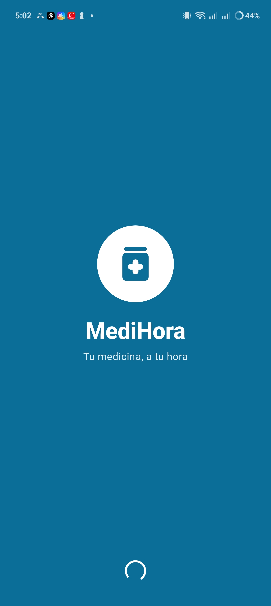

### Autenticación
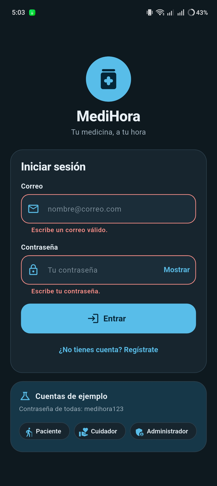
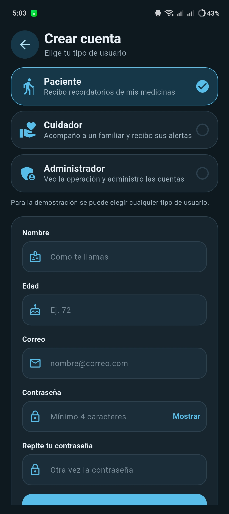

### Dashboards
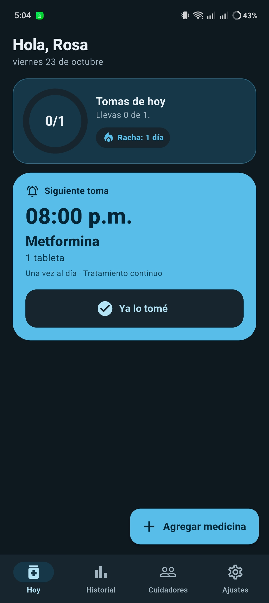
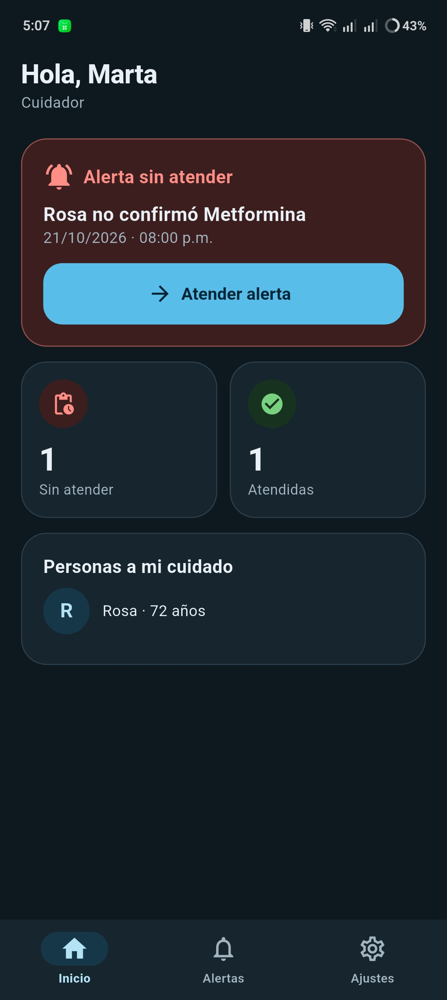
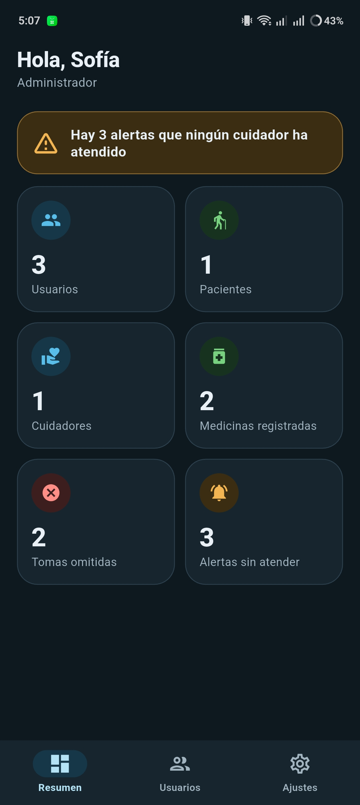

### Listas
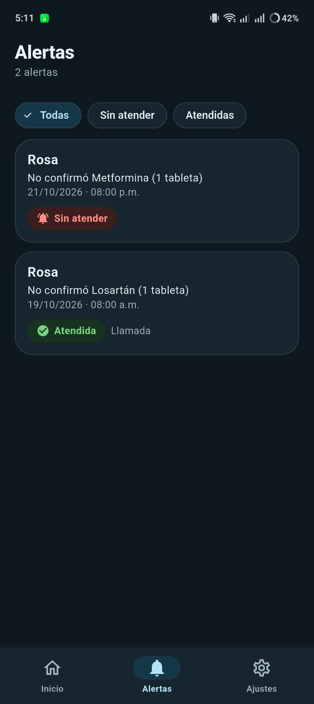
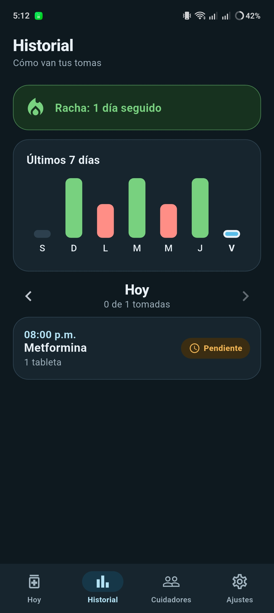
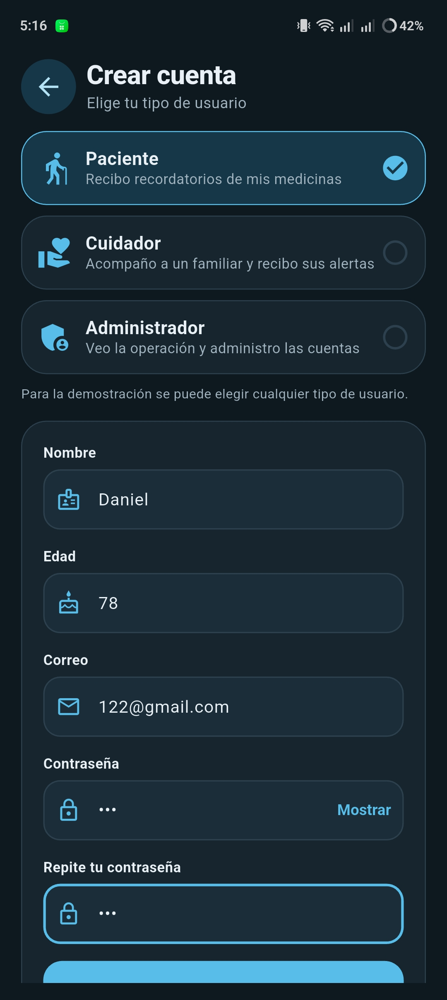

### Formularios
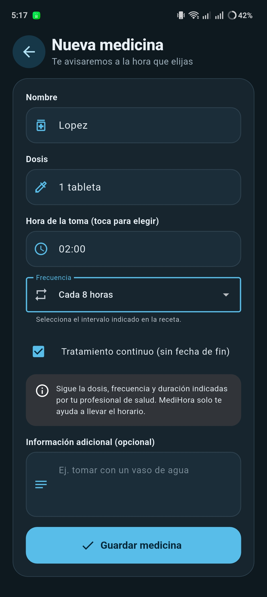
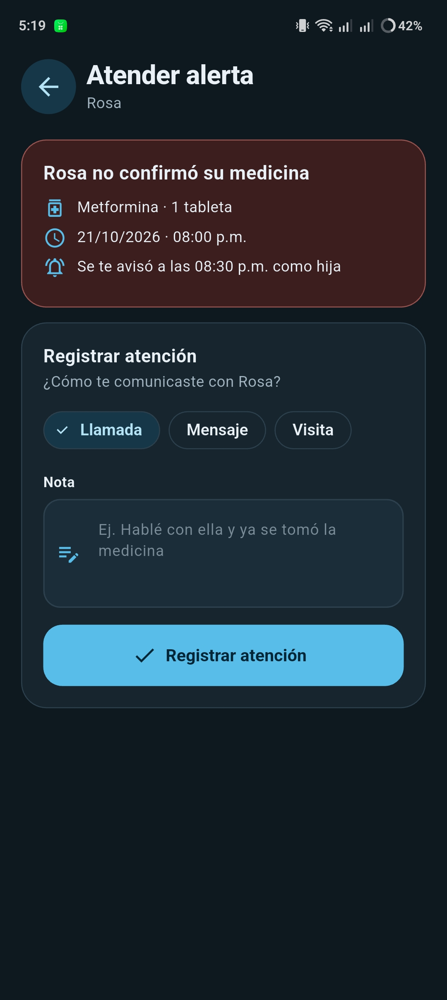
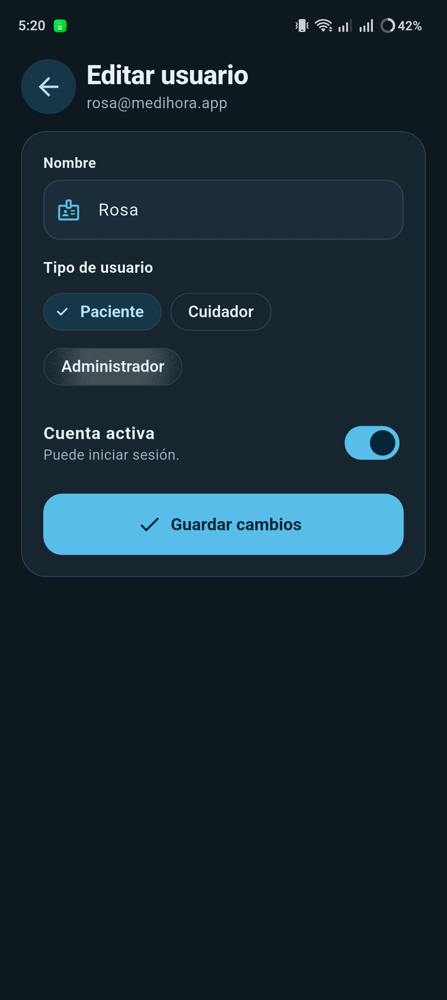


### Evidencia funcional
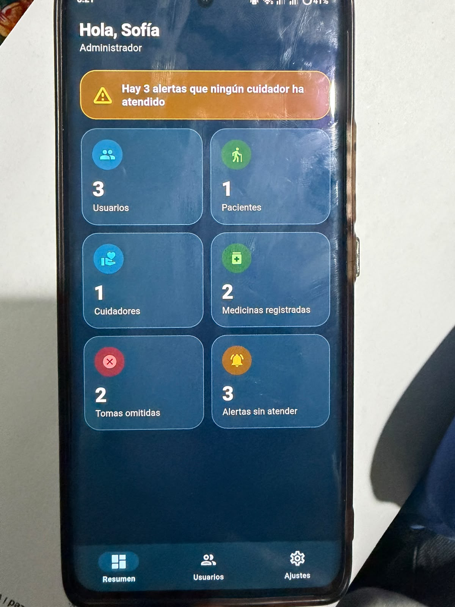


## 7. Estructura del proyecto y patrones de diseño

```
lib/
├── core/                     fechas, ids, reloj, hash de contraseña
├── domain/                   reglas del negocio (Dart puro, sin Flutter)
│   ├── entities/             Usuario, Cuidador, Medicamento, Toma, Recordatorio,
│   │                         AlertaCuidador, TomaDetalle, AlertaDetalle
│   ├── value_objects/        Correo, Dosis, Horario, Contacto, Parentesco, Racha,
│   │                         ResumenDiario, ResumenAdmin, RolUsuario y los estados
│   ├── builders/             MedicamentoBuilder             (patrón Builder)
│   ├── repositories/         MediHoraRepository (interfaz)  (patrón Repository)
│   └── services/             SeguimientoService (lógica), AvisoService y AlertaService
├── data/                     implementaciones
│   ├── memoria_medihora_repository.dart   en memoria (pruebas)
│   ├── local_medihora_repository.dart     guarda en el dispositivo
│   ├── datos_demo.dart                    cuentas y datos de ejemplo
│   └── adapters/             AvisoEnAppAdapter y AlertaSimuladaAdapter  (patrón Adapter)
├── presentation/
│   ├── app_state.dart        ChangeNotifier con un Timer    (patrón Observer)
│   ├── app_scope.dart        entrega el estado a las pantallas
│   ├── tema.dart             colores del modo claro y oscuro (context.c) y estilos de texto
│   └── widgets/              componentes, barra de pestañas, dashboard y el diálogo de aviso
└── screens/                  splash, login, registro y las pantallas de cada tipo de usuario
```

| Patrón | Familia | Capa | Archivo |
|---|---|---|---|
| Builder | Creacional | Lógica de negocio | `domain/builders/medicamento_builder.dart` |
| Adapter | Estructural | Datos | `data/adapters/` (implementan `AvisoService` y `AlertaService`) |
| Observer | Comportamiento | Lógica de negocio y Presentación | `presentation/app_state.dart` |
| Repository | Emergente | Datos | `domain/repositories/` + `data/*_medihora_repository.dart` |

## 8. Decisiones y límites

- El aviso a los cuidadores es **simulado** (se escribe en la consola); no hay SMS ni correos reales.
- **Cualquiera puede elegir cualquier tipo de usuario al registrarse**, porque la actividad lo pide. En una app real el tipo
  Cuidador o Administrador lo controlaría un servidor.
- Un cuidador se vincula con un paciente por el **correo**; un cuidador agregado solo con teléfono no tiene cuenta propia.
- Los datos viven en el dispositivo: no hay servidor ni notificaciones del sistema.
- La contraseña se guarda como hash SHA-256 sin sal (suficiente para la demostración).
- Los días de historial de ejemplo se calculan a partir de la fecha en que se abre la app por primera vez.
- El modo claro u oscuro **no se elige dentro de la app**: sigue siempre al teléfono (`ThemeMode.system`).
